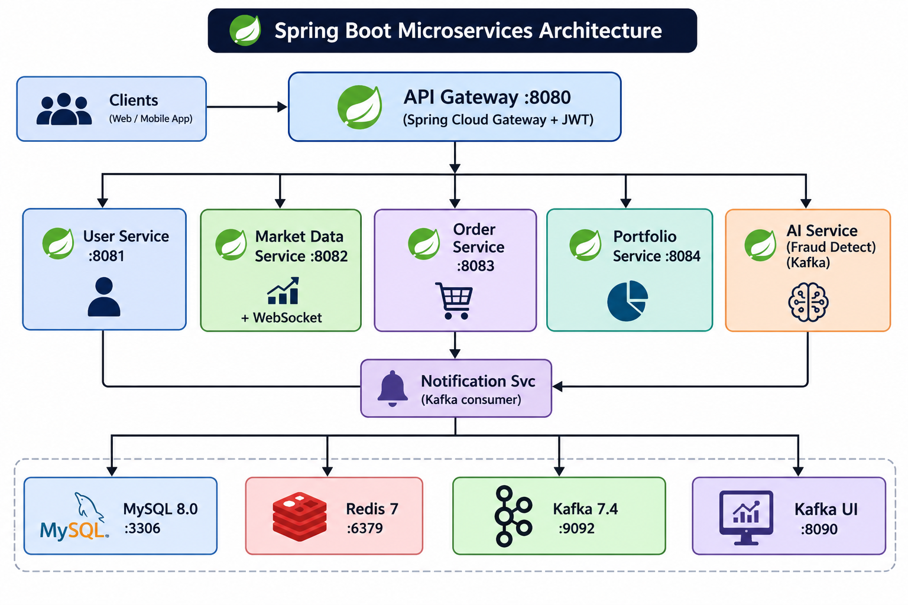

# Stock Trading Platform: Microservices


A stock trading platform built with **Java and Spring Boot microservices** and containerized with Docker Compose. It includes user management, real-time market data over WebSocket, order processing, portfolio tracking, a JWT-secured API Gateway, Kafka-based fraud detection, and a notification service.

This README covers the architecture, services, API contracts, configuration, and local setup.

## Table of Contents

- [Features](#features)
- [Architecture](#architecture)
- [Tech Stack](#tech-stack)
- [Services Overview](#services-overview)
- [Getting Started](#getting-started)
- [Configuration](#configuration)
- [Infrastructure](#infrastructure)
- [Authentication Flow](#authentication-flow)
- [API Reference](#api-reference)
- [API Gateway Routing](#api-gateway-routing)
- [Event-Driven Communication](#event-driven-communication)
- [Data Flow](#data-flow)
- [Project Structure](#project-structure)
- [Troubleshooting](#troubleshooting)
- [Security Notes](#security-notes)
- [Contributing](#contributing)
- [License](#license)

## Features

- Microservices backend with a centralized API Gateway and JWT authentication
- User registration, login, and wallet management
- Stock data through REST and real-time WebSocket streaming
- Asynchronous order placement and processing via Kafka
- Per-user portfolio and holdings
- Kafka-based fraud detection (AI Service)
- Multi-channel notifications (in-app, email, push)
- Unified Swagger/OpenAPI documentation
- One-command local setup with Docker Compose

## Architecture



The API Gateway is the single entry point for clients. It routes requests to the backend services and enforces JWT authentication on protected routes. Kafka handles asynchronous communication between services.

> If the diagram does not render on GitHub, confirm that `docs/architecture.png` exists and that the filename and letter case match the link.

## Tech Stack

| Layer | Technology |
|-------|------------|
| Language / Framework | Java, Spring Boot |
| API Gateway | Spring Cloud Gateway (WebFlux) |
| Security | Spring Security, JWT (access and refresh tokens) |
| Persistence | MySQL 8.0, Spring Data JPA |
| Caching | Redis 7 |
| Messaging | Kafka (Confluent Platform 7.4.0, KRaft mode, no Zookeeper) |
| Real-time | WebSocket |
| AI / Fraud Detection | Kafka consumer-based service |
| API Docs | SpringDoc OpenAPI, Swagger UI |
| Containerization | Docker, Docker Compose |
| Monitoring | Spring Boot Actuator |

## Services Overview

| Service | Port | Responsibility | Swagger (direct) |
|---------|------|----------------|------------------|
| **API Gateway** | 8080 | Entry point, JWT auth, routing, Swagger aggregation | http://localhost:8080/swagger-ui/index.html |
| **User Service** | 8081 | Registration, login, JWT issuing, wallet funds | http://localhost:8081/swagger-ui/index.html |
| **Market Data Service** | 8082 | Stock REST endpoints and WebSocket stream | http://localhost:8082/swagger-ui/index.html |
| **Order Service** | 8083 | Place and retrieve orders, async processing | http://localhost:8083/swagger-ui/index.html |
| **Portfolio Service** | 8084 | User portfolio and holdings | http://localhost:8084/swagger-ui/index.html |
| **Notification Service** | 8085 | Kafka-based notifications (in-app, email, push) | http://localhost:8085/swagger-ui/index.html |
| **AI Service** | n/a | Kafka-based fraud detection | n/a |
| **Kafka UI** | 8090 | Kafka cluster inspection and management | http://localhost:8090 |

> **Unified Swagger UI:** open http://localhost:8080/swagger-ui/index.html and choose a service from the **Select a definition** dropdown.

## Getting Started

### Prerequisites

- Git
- Docker 24+ (Docker Desktop or Docker Engine) and Docker Compose v2
- JDK 17+ and Maven (only if running services outside Docker)

Verify your tools:

```bash
git --version
docker --version
docker compose version
```

### 1. Clone the repository

```bash
git clone <YOUR_REPOSITORY_URL>
cd <YOUR_PROJECT_DIRECTORY>
```

### 2. Configure environment variables

```bash
cp .env.example .env
```

On Windows PowerShell:

```powershell
Copy-Item .env.example .env
```

Edit `.env` and set strong values. See [Configuration](#configuration) for details.

### 3. Build and start the containers

```bash
docker compose up -d --build
```

### 4. Check container status

```bash
docker compose ps
```

MySQL, Redis, and Kafka must report `healthy` before dependent services start (enforced with `depends_on.condition: service_healthy`). The first startup can take about 60 seconds. If a container is unhealthy or exits, inspect its logs:

```bash
docker compose logs -f <service-name>
```

### 5. Open the platform

| Resource | URL |
|----------|-----|
| API Gateway | http://localhost:8080 |
| Unified Swagger UI | http://localhost:8080/swagger-ui/index.html |
| Gateway health (Actuator) | http://localhost:8080/actuator/health |
| Kafka UI | http://localhost:8090 |

Individual service Swagger URLs are listed in [Services Overview](#services-overview). They work only when the corresponding service is running.

### 6. Stop the application

```bash
docker compose down        # stop containers, keep volume data
docker compose down -v     # stop containers and delete volumes (WARNING: data loss)
```

### Running services without Docker

Start the required infrastructure (MySQL, Redis, Kafka) first and make sure each service's configuration points to the correct hostnames and ports. Then build and run the service with Maven (for example `mvn spring-boot:run` inside the service directory). Exact profiles and settings depend on each service's configuration.

## Configuration

Never commit secrets. Provide them through a local `.env` file (listed in `.gitignore`) and commit only a `.env.example` with placeholder values.

```env
# .env.example
MYSQL_ROOT_PASSWORD=change-me
MYSQL_DATABASE=trading
JWT_SECRET=change-me-to-a-long-random-string
```

| Variable | Used by | Description |
|----------|---------|-------------|
| `MYSQL_ROOT_PASSWORD` | MySQL, backend services | Database password |
| `MYSQL_DATABASE` | MySQL | Database name (default `trading`) |
| `JWT_SECRET` | API Gateway, User Service | Secret used to sign and validate JWTs |

> These names are examples. Use the exact variable names referenced by your `docker-compose.yml` and Spring Boot configuration.

## Infrastructure

| Component | Container | Port(s) | Details |
|-----------|-----------|---------|---------|
| MySQL 8.0 | `mysql` | 3306 | Database `trading`, volume `mysql-data`, healthcheck `mysqladmin ping` |
| Redis 7 (Alpine) | `redis` | 6379 | Volume `redis-data`, healthcheck `redis-cli ping` |
| Kafka (KRaft) | `kafka` | 9092 (host), 29092 (internal) | Single-node broker and controller, auto-create topics, 168 h retention, volume `kafka-data` |
| Kafka UI | `kafka-ui` | 8090 | Bootstrap server `kafka:29092`, depends on healthy `kafka` |

**Kafka listeners**

- `PLAINTEXT://kafka:29092`: internal and inter-broker traffic
- `CONTROLLER://kafka:9093`: KRaft controller
- `PLAINTEXT_HOST://0.0.0.0:9092`: host access

**Docker network and volumes**

| Type | Name | Purpose |
|------|------|---------|
| Network | `trading-network` | Bridge network for all containers |
| Volume | `mysql-data` | MySQL persistence |
| Volume | `redis-data` | Redis persistence |
| Volume | `kafka-data` | Kafka log persistence |

**JDBC URL (inside Docker)**

```text
jdbc:mysql://mysql:3306/trading?useSSL=false&allowPublicKeyRetrieval=true&serverTimezone=UTC
```

> `useSSL=false` is acceptable for local development only. Enable SSL in production.

## Authentication Flow

1. **Register:** `POST /api/v1/users/register`
2. **Login:** `POST /api/v1/users/login` returns an `accessToken` and `refreshToken`
3. **Authorize:** in Swagger UI click **Authorize** and enter `Bearer <accessToken>`
4. **Call protected endpoints** with the header `Authorization: Bearer <ACCESS_TOKEN>`

```bash
curl -X POST http://localhost:8080/api/v1/users/login \
  -H "Content-Type: application/json" \
  -d '{"email":"user@example.com","password":"your-password"}'
```

All protected routes pass through the gateway's `JwtAuthFilter`. Only `/api/v1/users/register` and `/api/v1/users/login` are public.

## API Reference

All endpoints are reached through the gateway at `http://localhost:8080`. The running Swagger UI is the source of truth if the implementation changes.

### User Service: `/api/v1/users`

| Method | Endpoint | Description | Auth |
|--------|----------|-------------|------|
| POST | `/api/v1/users/register` | Register a user | Public |
| POST | `/api/v1/users/login` | Log in | Public |
| GET | `/api/v1/users/me` | Logged-in user details | JWT |
| GET | `/api/v1/users/{userId}` | Get user by ID | JWT |
| POST | `/api/v1/users/{userId}/funds/add` | Add funds | JWT |
| POST | `/api/v1/users/{userId}/funds/credit` | Credit funds | JWT |
| POST | `/api/v1/users/{userId}/funds/deduct` | Deduct funds | JWT |

<details>
<summary>Schemas</summary>

**`RegisterRequest`**

| Field | Type | Constraints |
|-------|------|-------------|
| email | string | required |
| password | string | required, min 6 characters |
| firstName | string | required |
| lastName | string | required |
| initialDeposit | number | optional |

**`LoginRequest`**

| Field | Type | Constraints |
|-------|------|-------------|
| email | string | required |
| password | string | required, min 6 characters |

**`AuthResponse`**

| Field | Type |
|-------|------|
| userId | string |
| email | string |
| firstName | string |
| lastName | string |
| walletBalance | number |
| accessToken | string |
| refreshToken | string |
| tokenType | string |

**`UserResponse`**

| Field | Type |
|-------|------|
| id | string |
| email | string |
| firstName | string |
| lastName | string |
| walletBalance | number |
| status | string |
| createdAt | date-time |

</details>

### Market Data Service: `/api/v1/market`

| Method | Endpoint | Description | Auth |
|--------|----------|-------------|------|
| GET | `/api/v1/market/stocks` | Get all stocks | JWT |
| GET | `/api/v1/market/stocks/{symbol}` | Get stock by symbol | JWT |
| GET | `/api/v1/market/stocks/list` | List stock symbols | JWT |
| WS | `/ws/**` | Real-time market data stream | As configured |

<details>
<summary>Schemas</summary>

**`StockPrice`**

| Field | Type |
|-------|------|
| symbol | string |
| companyName | string |
| price | number |
| change | number |
| changePercent | number |
| high | number |
| low | number |
| open | number |
| volume | integer (int64) |
| timestamp | date-time |

**`Stock`**

| Field | Type |
|-------|------|
| symbol | string |
| companyName | string |
| initialPrice | number |
| exchange | string |
| currency | string |
| active | boolean |

</details>

### Order Service: `/api/v1/orders`

| Method | Endpoint | Description | Auth |
|--------|----------|-------------|------|
| POST | `/api/v1/orders` | Place an order | JWT |
| GET | `/api/v1/orders/{orderId}` | Get order by ID | JWT |
| GET | `/api/v1/orders/my-orders` | Logged-in user's orders | JWT |

<details>
<summary>Schemas</summary>

**`OrderRequest`**

| Field | Type | Constraints |
|-------|------|-------------|
| userId | string | optional |
| symbol | string | required |
| type | string (enum) | required |
| quantity | integer (int32) | min 10 |

**`Order`**

| Field | Type |
|-------|------|
| id | string |
| userId | string |
| symbol | string |
| type | string (enum) |
| status | string (enum) |
| quantity | integer (int32) |
| price | number |
| totalAmount | number |
| failureReason | string |
| createdAt | date-time |
| executedAt | date-time |

</details>

### Portfolio Service: `/api/v1/portfolio`

| Method | Endpoint | Description | Auth |
|--------|----------|-------------|------|
| GET | `/api/v1/portfolio/me` | Logged-in user's portfolio | JWT |
| GET | `/api/v1/portfolio/{userId}` | Portfolio by user ID | JWT |

See the service's Swagger documentation for the exact response fields.

### Notification Service: `/api/v1/notifications`

| Method | Endpoint | Description | Auth |
|--------|----------|-------------|------|
| GET | `/api/v1/notifications` | Logged-in user's notifications | JWT |
| GET | `/api/v1/notifications/{notificationId}` | Get notification by ID | JWT |
| PATCH | `/api/v1/notifications/{notificationId}/read` | Mark notification as read | JWT |

<details>
<summary>Schemas</summary>

**`Notification`**

| Field | Type |
|-------|------|
| id | string |
| userId | string |
| type | enum: `ORDER_UPDATE`, `FRAUD_ALERT`, `SECURITY`, `MARKET_ALERT` |
| channel | enum: `IN_APP`, `EMAIL`, `PUSH` |
| title | string |
| message | string |
| status | enum: `PENDING`, `SENT`, `FAILED`, `READ` |
| referenceId | string |
| createdAt | date-time |
| readAt | date-time |

**`NotificationRequest`**

| Field | Type | Constraints |
|-------|------|-------------|
| userId | string | required |
| type | enum | required |
| channel | enum | required |
| title | string | required |
| message | string | required |
| referenceId | string | optional |

**`NotificationResponse`**

| Field | Type |
|-------|------|
| id | string |
| userId | string |
| type | string |
| channel | string |
| title | string |
| message | string |
| status | string |
| createdAt | date-time |
| readAt | date-time |

</details>

### AI Service (Fraud Detection)

The AI Service is Kafka-only and exposes no REST API through the gateway. See [Event-Driven Communication](#event-driven-communication) for its topics.

## API Gateway Routing

**Public routes (no JWT)**

| Route ID | Path | Target |
|----------|------|--------|
| user-service-public | `/api/v1/users/register`, `/api/v1/users/login` | `http://localhost:8081` |

**Protected routes (`JwtAuthFilter`)**

| Route ID | Path | Target |
|----------|------|--------|
| user-service | `/api/v1/users/**` | `http://localhost:8081` |
| market-data-service | `/api/v1/market/**` | `http://localhost:8082` |
| order-service | `/api/v1/orders/**` | `http://localhost:8083` |
| portfolio-service | `/api/v1/portfolio/**` | `http://localhost:8084` |
| notification-service | `/api/v1/notifications/**` | `http://localhost:8085` |

**WebSocket route**

| Route ID | Path | Target |
|----------|------|--------|
| market-websocket | `/ws/**` | `ws://localhost:8082` |

**Swagger documentation routes**

| Route ID | Path | Target |
|----------|------|--------|
| user-service-docs | `/user-service/v3/api-docs` | `http://localhost:8081` |
| market-data-service-docs | `/market-data-service/v3/api-docs` | `http://localhost:8082` |
| order-service-docs | `/order-service/v3/api-docs` | `http://localhost:8083` |
| portfolio-service-docs | `/portfolio-service/v3/api-docs` | `http://localhost:8084` |
| notification-service-docs | `/notification-service/v3/api-docs` | `http://localhost:8085` |

> **Running in Docker:** replace `localhost` with the service names (for example `http://user-service:8081`) in the gateway routes.

**Gateway configuration (`application.yml`)**

```yaml
server:
  port: 8080

jwt:
  secret: ${JWT_SECRET}

springdoc:
  swagger-ui:
    path: /swagger-ui.html
    urls:
      - name: user-service
        url: /user-service/v3/api-docs
      - name: market-data-service
        url: /market-data-service/v3/api-docs
      - name: order-service
        url: /order-service/v3/api-docs
      - name: portfolio-service
        url: /portfolio-service/v3/api-docs
      - name: notification-service
        url: /notification-service/v3/api-docs
```

## Event-Driven Communication

Kafka carries asynchronous communication between services.

| Topic | Producer | Consumer | Purpose |
|-------|----------|----------|---------|
| `order-events` | Order Service | AI Service, Notification Service | New orders to evaluate and notify about |
| `user-events` | User Service | AI Service, Notification Service | Registration and login anomalies |
| `fraud-events` | AI Service | Notification Service | Fraud detection verdicts |

> Confirm the producer and consumer assignments and topic names against the source code.

## Data Flow

1. **User Service** registers and authenticates users, issues JWTs, and manages wallet balance.
2. **Market Data Service** serves stock data over REST and streams live prices over WebSocket.
3. **Order Service** receives and stores orders, then publishes order events to Kafka.
4. **AI Service** consumes events, applies fraud rules, and publishes fraud verdicts.
5. **Notification Service** consumes order, fraud, and user events and delivers notifications.
6. **Portfolio Service** exposes each user's holdings.
7. **API Gateway** routes client requests and applies JWT authentication.

## Project Structure

```text
.
├── docker-compose.yml
├── .env.example
├── .gitignore
├── LICENSE
├── README.md
├── docs/
│   └── architecture.png
├── api-gateway/
│   └── README.md
├── user-service/
│   └── README.md
├── market-data-service/
│   └── README.md
├── order-service/
│   └── README.md
├── portfolio-service/
│   └── README.md
├── notification-service/
│   └── README.md
└── ai-service/
    └── README.md
```

## Troubleshooting

| Issue | What to check |
|-------|---------------|
| Services fail at startup | Wait for MySQL, Redis, and Kafka healthchecks (up to about 60 s) and inspect service logs. |
| `401 Unauthorized` | Log in first and provide a valid `Bearer <token>`. |
| Swagger dropdown is empty | Make sure every service-docs route resolves and the services are running; check gateway logs. |
| Kafka connection refused | Run `docker compose logs kafka` and check listeners and bootstrap-server settings. |
| MySQL authentication errors | Verify the datasource password matches `MYSQL_ROOT_PASSWORD` in `.env`. |
| Gateway cannot reach services in Docker | Use Docker service names and container ports instead of `localhost` in gateway routes. |
| Notification or AI service unavailable | Check that the service is defined and configured in `docker-compose.yml`. |

Useful commands:

```bash
docker compose ps                        # list containers
docker compose logs -f                   # follow all logs
docker compose logs -f <service-name>    # follow one service
docker compose restart <service-name>    # restart one service
```

## Security Notes

- Never commit real passwords, JWT secrets, API keys, or other credentials.
- Keep `.env` out of source control and commit only a safe `.env.example`.
- Rotate any credential that was previously committed or exposed.
- Use a strong, unique JWT signing secret.
- Restrict access to database and infrastructure ports in production.
- Verify authorization on wallet, order, and portfolio operations (for example, that users can only access their own `userId`) before deploying.
- Treat this project as a development/demo platform unless its security, reliability, and financial controls have been independently reviewed.

## Contributing

Contributions, suggestions, and bug reports are welcome.

1. Fork the repository
2. Create a feature branch: `git checkout -b feature/your-feature`
3. Make your changes and add or update tests
4. Verify the project builds and runs as expected
5. Commit and push: `git commit -m "Add your feature"` then `git push origin feature/your-feature`
6. Open a Pull Request describing your changes

## License

This project is licensed under the MIT License. See the [LICENSE](LICENSE) file for details.

Copyright (c) 2026 Sagar Thapa
